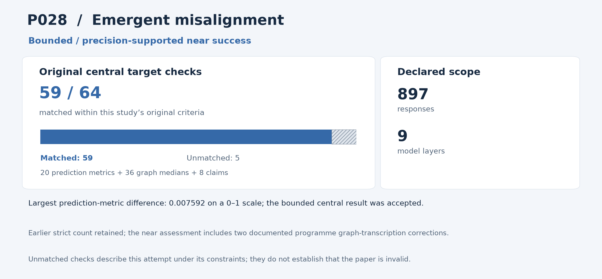

# P028: Convergent Linear Representations of Emergent Misalignment

**Outcome: Near success.** This is a central-result reproduction; whole-paper reproduction is not claimed.

**Interpreting non-reproduction.** A failed comparison or unmatched result means that this reproduction programme did not recover that result within its stated scope and constraints, including the available inputs, methods, software and local resources. It does not establish that the paper or its conclusions are invalid. Work outside the attempted scope was not tested by this programme.

[Source and acquisition records](INPUTS.json) · [Programme overview](../../README.md)

## Study in plain language

### What the original authors studied

Can simple measurements inside a language model distinguish responses labelled aligned from responses labelled misaligned? The authors studied a “probe”: a small classifier trained to recognize a pattern in a larger model’s internal measurements. Recognizing a pattern is different from showing that the pattern causes the model’s behaviour.

### What the reproduction programme checked

The reproduction programme downloaded the authors’ saved measurements and response provenance, covering 897 responses and 55,386 tokens, the pieces of text processed by the model. The reproduction code fitted the authors’ linear-probe procedure across all four comparisons and nine layers, preserving its labels, balancing, normalization, splits and seeds. The analysis compared all 20 reported prediction metrics, 36 summaries of classifier weights and eight claims. A separately written reproduction auditor reconstructed the inputs and refitted the classifiers.

### What was reproduced and what it means

The programme’s attempt is a retrospective bounded near success. Its prediction-metric differences were at most 0.007592 on a 0–1 scale; all graphical comparisons met the unchanged bound. All 6,083 independent checks passed. The programme’s strict result remains 59/64, including documented corrections to two of its graph transcriptions. Its inability to match every target with the available inputs, methods and resources does not determine the paper’s validity. Tokens from one response can appear on both sides of the authors’ split, limiting generalization claims. Model training, new responses, causal steering and fresh external model judgments were not attempted by the programme.

The sections below give the detailed comparisons and caveats. For common statistical and model terms, see the [reading guide](../../READING_GUIDE.md).

## Reproduction at a glance

The chart retains this programme's original central comparison criteria alongside the adopted outcome. Targets differ across studies and are not a common quality score. [Chart data](visuals/summary.json) · [Graph definitions and rendering code](../../visuals/README.md).

**Result.** The complete saved-activation probe study is a bounded near success, with all of the programme's original failed comparison flags preserved.

## What was reproduced

All 897 responses, 55,386 tokens, nine layers, four classifier contrasts, 20 Table 1 metrics, 36 graphical coefficient medians and eight claims remain. The computation includes 800 original-scope fits and 400 prespecified diagnostics.

## Agreement and differences

Maximum metric error is 0.007592365 on the 0–1 scale, within 0.010. All 36 graphical medians meet the unchanged 0.020 bound; maximum error is 0.014542980. All eight claims and 6,083 independent checks pass. The programme's original strict comparison result remains 59/64.

**Limits of this reproduction:** The retained strict misses are outcomes of this programme's comparison with saved activations and published summaries; two earlier misses arose from the programme's own graph transcriptions. The remaining limits and unmatched targets do not establish that the paper or its conclusions are invalid.

## Issues and omitted work

Two of five old failures were the reproduction programme's previously documented graph-transcription errors: medical-panel layers 27/28 are approximately -0.06/-0.03. Correction used the original page; graphical tolerance was not widened. Token-level leakage/dependence and missing response-level independence information remain limitations.

Base-model training, new generation, causal steering/interventions and fresh external model judging were not reproduced. Probe agreement is not proof of a causal misalignment mechanism.

The near classification is retrospective. No data, labels, estimator, seeds or fits were changed for reclassification.

## Paper and selection

- [Original paper or public release](https://arxiv.org/abs/2506.11618)

- Identified public release: 2025-06-13.
- Retained selection observation: 71 citations, Semantic Scholar. Exact capture time unknown.
- Original June 13 v1; related source history retained without a later-version date reset.
- Citation values are retained selection evidence, not current counts.

The route was **released activations + fresh probes**, using local computation without paid services or additional API keys. The code below is the programme's implementation and independent audit tooling for this scope.

## Code and rerunning

Start with [REPRODUCE.md](REPRODUCE.md). It identifies the scientific entry points, dependencies, historical commands and known execution constraints. The following code is included in this folder:

- [audit_probe.py](code/audit_probe.py) — primary_or_independent_scientific_entry
- [run_probe.py](code/run_probe.py) — primary_or_independent_scientific_entry

The folder also provides [a local artifact tool](reproduce.py), [input acquisition records](INPUTS.json), and [source-to-publication hashes](PROVENANCE.json). The artifact tool can check file integrity or reconstruct the original relative layout; it does not rerun the scientific experiment.

## Results and audit trail

- [P028_near_success_adoption933__ROOT_WHOLE64_NEAR_VECTOR933.json](results/P028_near_success_adoption933__ROOT_WHOLE64_NEAR_VECTOR933.json) — Complete aggregate target/error/audit ledger; exclude underlying participant rows, predictions, logits and bootstrap arrays
- [P028-central-001__comparison.json](results/P028-central-001__comparison.json) — Complete aggregate target/error/audit ledger; exclude underlying participant rows, predictions, logits and bootstrap arrays
- [P028-central-001__manifest.json](results/P028-central-001__manifest.json) — Archived numerical result, complete target comparison, audit or run metadata

- [INDEPENDENT_COMPLETE_P028_ARCHIVED_WHOLE_CENTRAL_NEAR_SUPPORT_RSTAT001.json](evidence/INDEPENDENT_COMPLETE_P028_ARCHIVED_WHOLE_CENTRAL_NEAR_SUPPORT_RSTAT001.json) — Final pinned execution/configuration/audit record
- [ROOT_ADOPTED_P028_ARCHIVED_COMPLETE_CENTRAL_NEAR_RULE930.json](evidence/ROOT_ADOPTED_P028_ARCHIVED_COMPLETE_CENTRAL_NEAR_RULE930.json) — Final pinned execution/configuration/audit record

Pass/fail labels and unmatched values in the linked historical records describe this programme's checks under its recorded constraints; they are not judgments on paper validity. Missing or unattempted components were not tested.

The full included-file index is [PROVENANCE.json](PROVENANCE.json). The [historical report](evidence/HISTORICAL_REPORT.txt) preserves the counted report's original qualifications; old warehouse paths there are historical references rather than public download links. Published copies normalize workstation paths and UTF-8 encoding. Their hashes are recorded separately from the original archive hashes.
