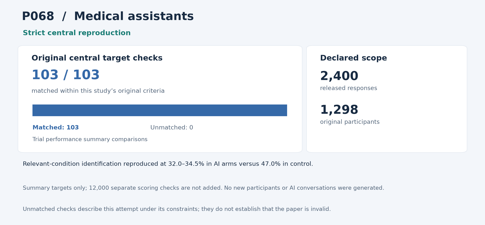

# P068: Reliability of LLMs as medical assistants for the general public: a randomized preregistered study

**Outcome: Strict central reproduction.** This is a central-result reproduction; whole-paper reproduction is not claimed.

**Interpreting non-reproduction.** A failed comparison or unmatched result means that this reproduction programme did not recover that result within its stated scope and constraints, including the available inputs, methods, software and local resources. It does not establish that the paper or its conclusions are invalid. Work outside the attempted scope was not tested by this programme.

[Paper / DOI](https://doi.org/10.1038/s41591-025-04074-y) · [arXiv](https://arxiv.org/abs/2504.18919) · [Source and acquisition records](INPUTS.json) · [Programme overview](../../README.md)

## Study in plain language

### What the original authors studied

A model can answer a medical exam question well without helping a person make a sound decision about symptoms. The authors tested that distinction in a randomized trial: people read fictional medical scenarios, suggested possible conditions and chose an urgency of care. They were assigned either one of three AI assistants or a control condition using their usual resources, mostly internet search or their own knowledge.

### What the reproduction programme checked

The reproduction programme analysed the released answers, rather than recruiting new people or holding new AI conversations. There were 2,400 responses from 1,298 participants across ten scenarios. Its code independently rescored each answer against the physicians' reference lists, using the original rule for recognising condition names, and checked whether the selected urgency matched the reference. The reproduction then rebuilt the comparisons between groups, including condition identification, serious conditions that should not be missed, and uncertainty around the estimates. Repeated responses from the same person were retained under the original response-level analysis.

### What was reproduced and what it means

The selected scoring and statistical results reproduced. In these released data, relevant-condition identification was about 32–35% in the AI-assisted groups versus 47% in control. That is a finding about this experiment and its scoring rules, not a new clinical test or a measure of actual patient harm. The report also retains the source-analysis limitations described below. Reproducing a calculation does not independently validate its assumptions; equally, limits of this reproduction do not establish that the paper is invalid.

The sections below give the detailed comparisons and caveats. For common statistical and model terms, see the [reading guide](../../READING_GUIDE.md).

## Reproduction at a glance

The chart retains this programme's original central comparison criteria alongside the adopted outcome. Targets differ across studies and are not a common quality score. [Chart data](visuals/summary.json) · [Graph definitions and rendering code](../../visuals/README.md).

**Result.** The complete selected human-trial performance analysis was reproduced from original participant answers and scoring lists.

## What was reproduced

All 2,400 responses from 1,298 participants, four randomized arms and ten scenarios remain included. Answers were independently rescored. The full condition-identification, red-flag, disposition, odds-ratio, uncertainty and acuity family was retained.

## Agreement and differences

All 12,000 scoring comparisons, 103 summary comparisons and 29,318 independent checks pass. Relevant-condition identification is 34.5%, 34.0% and 32.0% in the three LLM-assisted arms versus 47.0% in control; the source-defined corrected comparisons agree. Disposition differences remain nonsignificant.

The historical bootstrap seed is unavailable. A fixed disclosed seed was used with the original 0.02 stochastic endpoint allowance; deterministic comparisons retain separate precision limits.

**Limits of this reproduction:** All selected comparisons passed. The repaired serialization failure was an execution problem in this programme. Unavailable historical seeds and omitted analyses limit what was checked; they are not findings against the validity of the paper.

## Issues and omitted work

The source fuzzy-matching and response-level assumptions were preserved, including participants with multiple responses. An initial serialization failure in the programme was repaired without changing scientific methods or targets.

No new recruitment, conversations or model inference occurred. Separate model-only, simulated-user, interaction/precision, trust/demographic and appendix analyses were omitted. This reproduces released trial statistics, not a new clinical deployment test or patient-harm estimate.

## Paper and selection

- [Original paper or public release](https://doi.org/10.1038/s41591-025-04074-y)
- [Original paper or public release](https://arxiv.org/abs/2504.18919)

- Identified public release: 2025-04-17.
- Retained selection observation: 113 citations, Semantic Scholar. Exact capture time supported.
- April 2025 public data/code precede arXiv v1 and the later journal publication.
- Citation values are retained selection evidence, not current counts.

The route was **released trial data**, using local computation without paid services or additional API keys. The code below is the programme's implementation and independent audit tooling for this scope.

## Code and rerunning

Start with [REPRODUCE.md](REPRODUCE.md). It identifies the scientific entry points, dependencies, historical commands and known execution constraints. The following code is included in this folder:

- [p068_audit.py](code/p068_audit.py) — scientific entry
- [p068_central_serialization_corrected.py](code/p068_central_serialization_corrected.py) — scientific entry

The folder also provides [a local artifact tool](reproduce.py), [input acquisition records](INPUTS.json), and [source-to-publication hashes](PROVENANCE.json). The artifact tool can check file integrity or reconstruct the original relative layout; it does not rerun the scientific experiment.

## Results and audit trail

- [P068-audit-001__audit.json](results/P068-audit-001__audit.json) — successful original run/audit product, target comparison, figure or hash manifest
- [P068-audit-001__independent_scores.csv](results/P068-audit-001__independent_scores.csv) — successful original run/audit product, target comparison, figure or hash manifest
- [P068-audit-001__manifest.json](results/P068-audit-001__manifest.json) — successful original run/audit product, target comparison, figure or hash manifest
- [P068-central-002__PREREGISTRATION.json](results/P068-central-002__PREREGISTRATION.json) — successful original run/audit product, target comparison, figure or hash manifest
- [P068-central-002__PREREGISTRATION.md.txt](results/P068-central-002__PREREGISTRATION.md.txt) — successful original run/audit product, target comparison, figure or hash manifest
- [P068-central-002__manifest.json](results/P068-central-002__manifest.json) — successful original run/audit product, target comparison, figure or hash manifest
- [P068-central-002__original_row_targets.csv](results/P068-central-002__original_row_targets.csv) — Archived numerical result, complete target comparison, audit or run metadata
- [P068-central-002__results.json](results/P068-central-002__results.json) — successful original run/audit product, target comparison, figure or hash manifest
- [P068-central-002__scores.csv](results/P068-central-002__scores.csv) — successful original run/audit product, target comparison, figure or hash manifest
- [P068-central-002__sources_manifest.json](results/P068-central-002__sources_manifest.json) — successful original run/audit product, target comparison, figure or hash manifest
- [P068-central-002__targets.json](results/P068-central-002__targets.json) — successful original run/audit product, target comparison, figure or hash manifest

- [root_review_P068-central-002.json](evidence/root_review_P068-central-002.json) — compact independent/ROOT success and closure decision

Pass/fail labels and unmatched values in the linked historical records describe this programme's checks under its recorded constraints; they are not judgments on paper validity. Missing or unattempted components were not tested.

The full included-file index is [PROVENANCE.json](PROVENANCE.json). The [historical report](evidence/HISTORICAL_REPORT.txt) preserves the counted report's original qualifications; old warehouse paths there are historical references rather than public download links. Published copies normalize workstation paths and UTF-8 encoding. Their hashes are recorded separately from the original archive hashes.
