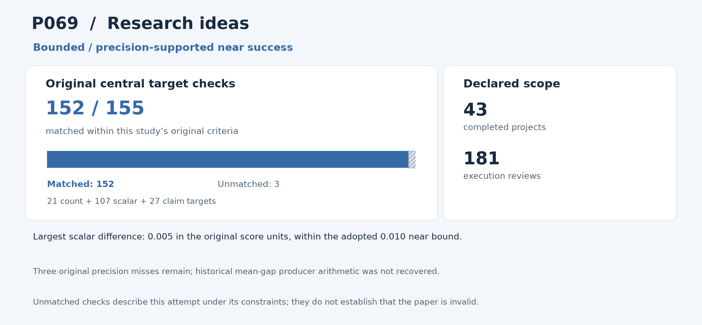

# P069: The Ideation-Execution Gap: Execution Outcomes of LLM-Generated versus Human Research Ideas

**Outcome: Near success.** This is a central-result reproduction; whole-paper reproduction is not claimed.

**Interpreting non-reproduction.** A failed comparison or unmatched result means that this reproduction programme did not recover that result within its stated scope and constraints, including the available inputs, methods, software and local resources. It does not establish that the paper or its conclusions are invalid. Work outside the attempted scope was not tested by this programme.

[Source and acquisition records](INPUTS.json) · [Programme overview](../../README.md)

## Study in plain language

### What the original authors studied

An appealing research idea may not lead to an equally strong finished project. The authors asked how ideas proposed by language models compare with human ideas once they have been developed into research projects. Their study used blinded human reviews, meaning reviewers were not told which source produced an idea.

### What the reproduction programme checked

The reproduction programme reanalysed the authors’ released idea and execution reviews for all 43 completed projects and all 181 execution reviews. Both idea-source groups and all seven evaluation measures were retained. The reproduction code reconstructed the authors’ review-level and project-level summaries, differences between idea and execution scores, correlations and specified exclusion checks. The analysis compared the entire set of 155 published targets. An independent reproduction implementation checked the data handling and arithmetic rather than simply importing the primary reproduction analysis.

### What was reproduced and what it means

The complete reproduction analysis is a retrospective bounded near success. All count and qualitative-claim targets agree; the largest difference among 107 numerical summaries is 0.005, within the adopted 0.010 bound in the original score units. All 1,127 independent checks pass. Three of the programme’s mean-gap comparisons do not meet its original precision rule, leaving its strict result at 152/155. These mismatches under the available inputs, methods and resources do not determine the paper’s validity. The programme did not attempt new idea generation, project execution or reviewer recruitment. Stable reviewer identifiers were unavailable to it, limiting analysis of dependence between reviews by the same person.

The sections below give the detailed comparisons and caveats. For common statistical and model terms, see the [reading guide](../../READING_GUIDE.md).

## Reproduction at a glance

The chart retains this programme's original central comparison criteria alongside the adopted outcome. Targets differ across studies and are not a common quality score. [Chart data](visuals/summary.json) · [Graph definitions and rendering code](../../visuals/README.md).

**Result.** The complete execution-study review analysis is a bounded near success; the original strict result remains 152/155.

## What was reproduced

All 181 reviews, 43 executed projects, both human/LLM-idea arms, seven metrics, original correlations and exclusion-robustness analyses were retained. Every original target was assessed.

## Agreement and differences

All 21 count targets and 27 qualitative claims agree. The largest error across 107 scalar targets is 0.005, within the adopted 0.010 natural-unit bound. All 1,127 independent checks pass. The programme still could not match the same three published mean-gap summaries under its old precision rule.

**Limits of this reproduction:** The programme could not match the remaining mean-gap summaries at the original precision with the released reviews and available calculation history. Their producer arithmetic remains unresolved. This records a limitation of the reproduction attempt, without determining whether the paper or its conclusions are valid.

## Issues and omitted work

The producer arithmetic for the mean-gap discrepancies is unresolved. Missing stable reviewer identifiers limit reconstruction of reviewer-level dependence. Canonical text-encoded counts/Boolean flags were decoded without altering statistics.

Fresh idea generation, project execution, recruitment and reviewing were not repeated; unsupported reviewer-level inference was not added. The central comparison and conclusions reproduce within a small numerical error.

This is a retrospective application of the user’s later bounded-error instruction, not an original preregistered strict success or a new experiment. The earlier ideation-only study is distinct from this execution study.

## Paper and selection

- [Original paper or public release](https://arxiv.org/abs/2506.20803)

- Identified public release: 2025-06-25.
- Retained selection observation: 62 citations, Semantic Scholar. Exact capture time unknown.
- Distinct June 2025 execution study, not its 2024 idea-only predecessor or planning registration.
- Citation values are retained selection evidence, not current counts.

The route was **released review data**, using local computation without paid services or additional API keys. The code below is the programme's implementation and independent audit tooling for this scope.

## Code and rerunning

Start with [REPRODUCE.md](REPRODUCE.md). It identifies the scientific entry points, dependencies, historical commands and known execution constraints. The following code is included in this folder:

- [p069_audit_setup_corrected.py](code/p069_audit_setup_corrected.py) — primary_or_independent_scientific_entry
- [p069_central.py](code/p069_central.py) — primary_or_independent_scientific_entry

The folder also provides [a local artifact tool](reproduce.py), [input acquisition records](INPUTS.json), and [source-to-publication hashes](PROVENANCE.json). The artifact tool can check file integrity or reconstruct the original relative layout; it does not rerun the scientific experiment.

## Results and audit trail

- [environment__ROOT_INDEPENDENT_ARCHIVED_P069_ALL155_BOUND_CHECK917.json](results/environment__ROOT_INDEPENDENT_ARCHIVED_P069_ALL155_BOUND_CHECK917.json) — Complete aggregate target/error/audit ledger; exclude underlying participant rows, predictions, logits and bootstrap arrays
- [github_publication_prep__CPU_NEAR9_P069_PRIMARY_COMPACT_AGGREGATE_RESULTS.json](results/github_publication_prep__CPU_NEAR9_P069_PRIMARY_COMPACT_AGGREGATE_RESULTS.json) — Exact primary aggregate-only complete target projection; no underlying participant rows

- [INDEPENDENT_COMPLETE_P069_ARCHIVED_NEAR_SUPPORT_REVIEW_RSTAT001.json](evidence/INDEPENDENT_COMPLETE_P069_ARCHIVED_NEAR_SUPPORT_REVIEW_RSTAT001.json) — Final pinned execution/configuration/audit record
- [ROOT_ADOPTED_ARCHIVED_P069_NEAR_SUCCESS_REVIEW_RULE916.json](evidence/ROOT_ADOPTED_ARCHIVED_P069_NEAR_SUCCESS_REVIEW_RULE916.json) — Final pinned execution/configuration/audit record
- [INDEPENDENT_COMPLETE_P069_ARCHIVED_NEAR_SUPPORTED916_CPU001.json](evidence/INDEPENDENT_COMPLETE_P069_ARCHIVED_NEAR_SUPPORTED916_CPU001.json) — Final pinned execution/configuration/audit record
- [REPORT.md.txt](evidence/REPORT.md.txt) — Final pinned execution/configuration/audit record

Pass/fail labels and unmatched values in the linked historical records describe this programme's checks under its recorded constraints; they are not judgments on paper validity. Missing or unattempted components were not tested.

The full included-file index is [PROVENANCE.json](PROVENANCE.json). The [historical report](evidence/HISTORICAL_REPORT.txt) preserves the counted report's original qualifications; old warehouse paths there are historical references rather than public download links. Published copies normalize workstation paths and UTF-8 encoding. Their hashes are recorded separately from the original archive hashes.
