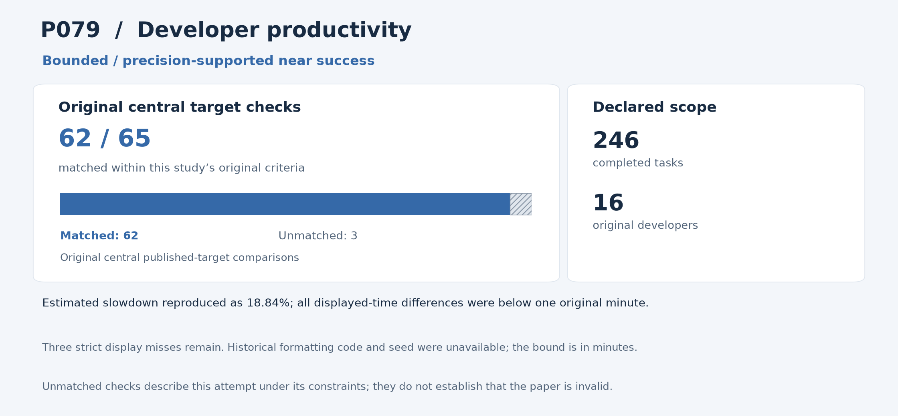

# P079: Measuring the Impact of Early-2025 AI on Experienced Open-Source Developer Productivity

**Outcome: Near success.** This is a central-result reproduction; whole-paper reproduction is not claimed.

**Interpreting non-reproduction.** A failed comparison or unmatched result means that this reproduction programme did not recover that result within its stated scope and constraints, including the available inputs, methods, software and local resources. It does not establish that the paper or its conclusions are invalid. Work outside the attempted scope was not tested by this programme.

[Source and acquisition records](INPUTS.json) · [Programme overview](../../README.md)

## Study in plain language

### What the original authors studied

Does access to an AI coding assistant make experienced developers faster on real work? The authors’ trial followed 16 developers completing tasks in familiar open-source projects, with AI access allowed for some tasks and disallowed for others. Its finding concerns this particular trial, rather than every developer or coding tool.

### What the reproduction programme checked

The reproduction programme used all 246 completed tasks in the authors’ released dataset. Following the authors’ code, the reproduction analysis reconstructed completion times, handled missing review time and fitted the regressions that estimate the AI-access effect while accounting for specified differences between tasks and developers. It also repeated the alternative estimates, forecast comparisons, balance checks and fixed bootstrap calculations. A bootstrap repeatedly resamples observed tasks to describe uncertainty. The independent reproduction auditor checked all 150,000 saved draws and the full set of 65 targets.

### What was reproduced and what it means

The reproduction analysis estimated a slowdown of 18.84%, matching the authors’ reported 18.8–19%. This is a retrospective bounded near success: all 55 non-display targets retain their original passing limits, while all ten integer-displayed time summaries differ by less than one minute. The programme could not match three under its old strict display checks, leaving 62/65 unchanged. All 1,782 independent checks pass. Those mismatches within its available inputs, methods and resources do not determine the paper’s validity. The programme did not attempt a new developer trial, current-assistant comparison or independent assessment of code quality; unreleased trial information and historical formatting choices remained unavailable to it.

The sections below give the detailed comparisons and caveats. For common statistical and model terms, see the [reading guide](../../READING_GUIDE.md).

## Reproduction at a glance

The chart retains this programme's original central comparison criteria alongside the adopted outcome. Targets differ across studies and are not a common quality score. [Chart data](visuals/summary.json) · [Graph definitions and rendering code](../../visuals/README.md).

**Result.** The complete developer-productivity reanalysis is a bounded near success; its original 62/65 strict result is retained.

## What was reproduced

All 246 completed tasks, 16 developers, both trial arms, 65 original targets and fixed bootstrap comparisons were included, preserving the source estimator and missingness choices.

## Agreement and differences

Estimated slowdown with AI access is 18.8400%, consistent with the reported 18.8–19%. All 55 non-display targets retain their passing original limits. All ten integer-displayed completion-time summaries are within one minute; maximum error is 0.877005 minutes.

All 1,782 independent checks, including 150,000 bootstrap draws, pass. The programme's original three strict comparison failures remain.

**Limits of this reproduction:** The remaining strict misses concern this programme's recovery of displayed time summaries with unavailable historical formatting code and seed. Their cause is not established. Failure to match those displays within this setup does not establish that the paper or its conclusions are invalid.

## Issues and omitted work

The programme initially described its display bound with the wrong unit. It is one original minute, not one percentage point; correcting wording did not rescale it. Historical formatting code/seed are unavailable; truncation is possible but unproven. Source data/code conflicts remain disclosed.

No new developer trial, current assistant test, expert quality review or unreleased-covariate reconstruction occurred. The central slowdown and uncertainty reproduce for this trial, not all AI coding use.

Near classification is retrospective; no cohort, estimator or original failed comparison was changed.

## Paper and selection

- [Original paper or public release](https://arxiv.org/abs/2507.09089)
- [Original paper or public release](https://metr.org/blog/2025-07-10-early-2025-ai-experienced-os-dev-study/)

- Identified public release: 2025-07-10.
- Retained selection observation: 213 citations, Semantic Scholar. Exact capture time unknown.
- July 10 empirical announcement precedes July 12 arXiv v1.
- Citation values are retained selection evidence, not current counts.

The route was **released trial data**, using local computation without paid services or additional API keys. The code below is the programme's implementation and independent audit tooling for this scope.

## Code and rerunning

Start with [REPRODUCE.md](REPRODUCE.md). It identifies the scientific entry points, dependencies, historical commands and known execution constraints. The following code is included in this folder:

- [audit_central.py](code/audit_central.py) — primary_or_independent_scientific_entry
- [run_central.py](code/run_central.py) — primary_or_independent_scientific_entry

The folder also provides [a local artifact tool](reproduce.py), [input acquisition records](INPUTS.json), and [source-to-publication hashes](PROVENANCE.json). The artifact tool can check file integrity or reconstruct the original relative layout; it does not rerun the scientific experiment.

## Results and audit trail

- [P079-audit-001__AUDIT_MANIFEST.json](results/P079-audit-001__AUDIT_MANIFEST.json) — Archived numerical result, complete target comparison, audit or run metadata
- [P079-audit-001__LAUNCH_RESULT.json](results/P079-audit-001__LAUNCH_RESULT.json) — Archived numerical result, complete target comparison, audit or run metadata
- [P079-audit-001__audit.json](results/P079-audit-001__audit.json) — Complete aggregate target/error/audit ledger; exclude underlying participant rows, predictions, logits and bootstrap arrays
- [P079-audit-001__independent_target_decisions.json](results/P079-audit-001__independent_target_decisions.json) — Archived numerical result, complete target comparison, audit or run metadata
- [environment__ROOT_P079_ARCHIVED_COMPLETE65_NEAR_CHECK924.json](results/environment__ROOT_P079_ARCHIVED_COMPLETE65_NEAR_CHECK924.json) — Complete aggregate target/error/audit ledger; exclude underlying participant rows, predictions, logits and bootstrap arrays
- [P079-central-001__LAUNCH_RESULT.json](results/P079-central-001__LAUNCH_RESULT.json) — Archived numerical result, complete target comparison, audit or run metadata
- [P079-central-001__RUN_MANIFEST.json](results/P079-central-001__RUN_MANIFEST.json) — Archived numerical result, complete target comparison, audit or run metadata
- [P079-central-001__metrics.json](results/P079-central-001__metrics.json) — Archived numerical result, complete target comparison, audit or run metadata
- [P079-central-001__model_statistics.json](results/P079-central-001__model_statistics.json) — Complete aggregate target/error/audit ledger; exclude underlying participant rows, predictions, logits and bootstrap arrays
- [P079-central-001__target_decisions.json](results/P079-central-001__target_decisions.json) — Complete aggregate target/error/audit ledger; exclude underlying participant rows, predictions, logits and bootstrap arrays

- [ROOT_ADOPTED_P079_ARCHIVED_INTEGER_DISPLAY_NEAR_RULE923.json](evidence/ROOT_ADOPTED_P079_ARCHIVED_INTEGER_DISPLAY_NEAR_RULE923.json) — Final pinned execution/configuration/audit record
- [INDEPENDENT_COMPLETE_P079_ARCHIVED_NEAR_SUPPORTED923_CPU002.json](evidence/INDEPENDENT_COMPLETE_P079_ARCHIVED_NEAR_SUPPORTED923_CPU002.json) — Final pinned execution/configuration/audit record

Pass/fail labels and unmatched values in the linked historical records describe this programme's checks under its recorded constraints; they are not judgments on paper validity. Missing or unattempted components were not tested.

The full included-file index is [PROVENANCE.json](PROVENANCE.json). The [historical report](evidence/HISTORICAL_REPORT.txt) preserves the counted report's original qualifications; old warehouse paths there are historical references rather than public download links. Published copies normalize workstation paths and UTF-8 encoding. Their hashes are recorded separately from the original archive hashes.
