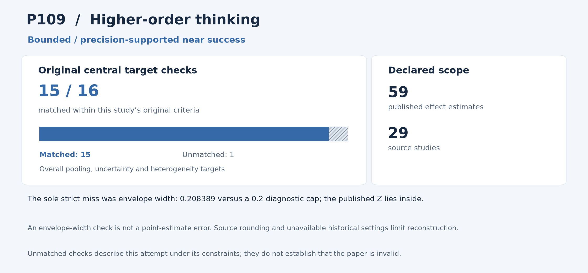

# P109: Does Generative Artificial Intelligence Improve Students’ Higher-Order Thinking? A Meta-Analysis Based on 29 Experiments and Quasi-Experiments

**Outcome: Near success.** This is a central-result reproduction; whole-paper reproduction is not claimed.

**Interpreting non-reproduction.** A failed comparison or unmatched result means that this reproduction programme did not recover that result within its stated scope and constraints, including the available inputs, methods, software and local resources. It does not establish that the paper or its conclusions are invalid. Work outside the attempted scope was not tested by this programme.

[Paper / DOI](https://doi.org/10.3390/jintelligence13120160) · [Source and acquisition records](INPUTS.json) · [Programme overview](../../README.md)

## Study in plain language

### What the original authors studied

Does generative AI improve students’ higher-order thinking? The authors addressed this through a meta-analysis: combining effect estimates from several studies rather than running one new classroom experiment. Their overall synthesis contains 59 effects from 29 experiments and quasi-experiments. Multiple effects can come from the same study.

### What the reproduction programme checked

The reproduction programme transcribed the authors’ published effect sizes and their reported precision, then reconstructed both fixed-effect and random-effects summaries. These approaches respectively assume a common effect or allow effects to vary between studies. The reproduction analysis propagated uncertainty caused by rounded input numbers and compared all 16 overall effect, interval and heterogeneity targets. Heterogeneity describes variation between study effects. A separate reproduction implementation using 80-digit arithmetic checked the complete calculation; it did not repeat the constituent trials.

### What was reproduced and what it means

The positive pooled effect reproduces under the declared assumptions: the reproduction analysis gives a random-effects estimate of 0.608797 versus the authors’ 0.609, with a closely matching uncertainty interval. This is a retrospective bounded near success; all 607 independent checks pass. The programme’s strict result remains 15/16: its rounding-uncertainty envelope exceeded the unchanged width limit, although it contains the published value. That mismatch with available inputs, methods and resources does not determine the paper’s validity. Original software settings and unrounded inputs were unavailable to the programme. Independent effects remain an assumption; four sets of source-incomplete subgroup comparisons were outside the attempted scope. The result supports the authors’ overall synthesis, not every educational use of AI.

The sections below give the detailed comparisons and caveats. For common statistical and model terms, see the [reading guide](../../READING_GUIDE.md).

## Reproduction at a glance

The chart retains this programme's original central comparison criteria alongside the adopted outcome. Targets differ across studies and are not a common quality score. [Chart data](visuals/summary.json) · [Graph definitions and rendering code](../../visuals/README.md).

**Result.** The complete overall 59-effect meta-analysis is a bounded near success. The programme's only strict comparison miss is a slightly over-wide source-rounding precision envelope.

## What was reproduced

All 59 effects from 29 experiments and all 16 fixed/random pooling, uncertainty and heterogeneity targets remain. The independent 80-digit reconstruction checks the whole overall synthesis.

## Agreement and differences

All 607 independent checks pass; the old strict result remains 15/16. Random-effects g=0.6087965551 versus 0.609, CI [0.4852213566, 0.7323717536] versus [0.485, 0.732].

Fixed-effect Z=19.4603025124 versus 19.483, error 0.0226974876 (0.1165%). The retained rounding enclosure [19.3543741681, 19.5627630247] contains the published value, but width 0.2083888565 exceeds its old 0.2 diagnostic cap by 0.0083888565. The cap is unchanged.

**Limits of this reproduction:** The failed strict check concerns the programme's rounding-envelope width criterion; the published test statistic remains inside that envelope. Unrounded inputs and historical software settings were unavailable. This is a limit of the attempted precision reconstruction, not a finding that the paper or its pooled result is invalid.

## Issues and omitted work

Rounding enclosures are marginal sensitivity bounds, not sampling intervals or proof of one jointly matching unrounded dataset. DerSimonian–Laird was fixed prospectively; original CMA settings/tau estimator are unknown. Multiple-effect independence and source count/wording conflicts remain.

Trials, searching/screening/extraction, private unrounded inputs and four source-incomplete moderator families were not reproduced. The programme's supporting alternative calculations did not meet the outstanding precision criterion either. This retrospective classification changes no estimator, subset, fit or precision cap.

## Paper and selection

- [Original paper or public release](https://doi.org/10.3390/jintelligence13120160)

- Identified public release: 2025-12-05.
- Retained selection observation: 47 citations, Semantic Scholar exact paper-ID batch. Exact capture time supported.
- Positive December5 version of record; earlier issue/index dates are not substantive-publication proof. Earlier failed requests supplied no numeric count.
- Citation values are retained selection evidence, not current counts.

The route was **released published-effect meta-analysis**, using local computation without paid services or additional API keys. The code below is the programme's implementation and independent audit tooling for this scope.

## Code and rerunning

Start with [REPRODUCE.md](REPRODUCE.md). It identifies the scientific entry points, dependencies, historical commands and known execution constraints. The following code is included in this folder:

- [audit_p109_central_002.py](code/audit_p109_central_002.py) — primary_or_independent_scientific_entry
- [run_p109_central_001.py](code/run_p109_central_001.py) — primary_or_independent_scientific_entry
- [supervise_p109_central_001.py](code/supervise_p109_central_001.py) — Required transitive local helper, native supervisor or full original reference route
- [supervise_p109_central_002.py](code/supervise_p109_central_002.py) — Required transitive local helper, native supervisor or full original reference route

The folder also provides [a local artifact tool](reproduce.py), [input acquisition records](INPUTS.json), and [source-to-publication hashes](PROVENANCE.json). The artifact tool can check file integrity or reconstruct the original relative layout; it does not rerun the scientific experiment.

## Results and audit trail

- [P109_archived_complete_synthesis_near_assessment_CPU052__ALL16_OR__5d4d24a4.json](results/P109_archived_complete_synthesis_near_assessment_CPU052__ALL16_OR__5d4d24a4.json) — Complete aggregate target/error/audit ledger; exclude underlying participant rows, predictions, logits and bootstrap arrays
- [P109-central-001__comparisons.json](results/P109-central-001__comparisons.json) — Complete aggregate target/error/audit ledger; exclude underlying participant rows, predictions, logits and bootstrap arrays
- [independent_audit002__AUDIT_MANIFEST.json](results/independent_audit002__AUDIT_MANIFEST.json) — Archived numerical result, complete target comparison, audit or run metadata
- [independent_audit002__AUDIT_STATUS.json](results/independent_audit002__AUDIT_STATUS.json) — Complete aggregate target/error/audit ledger; exclude underlying participant rows, predictions, logits and bootstrap arrays
- [independent_audit002__INDEPENDENT80_RESULTS.json](results/independent_audit002__INDEPENDENT80_RESULTS.json) — Archived numerical result, complete target comparison, audit or run metadata
- [P109-central-001__result.json](results/P109-central-001__result.json) — Archived numerical result, complete target comparison, audit or run metadata
- [P109-central-001__source_rounding_enclosures.json](results/P109-central-001__source_rounding_enclosures.json) — Complete aggregate target/error/audit ledger; exclude underlying participant rows, predictions, logits and bootstrap arrays

- [ADDITIVE_P109_RETAINED_IDENTITY_ELIGIBILITY_AND_WHOLE59_ALL16_SCOPE_P092053.json](evidence/ADDITIVE_P109_RETAINED_IDENTITY_ELIGIBILITY_AND_WHOLE59_ALL16_SCOPE_P092053.json) — Counted-scope decision, complete vector or independent review

Pass/fail labels and unmatched values in the linked historical records describe this programme's checks under its recorded constraints; they are not judgments on paper validity. Missing or unattempted components were not tested.

The full included-file index is [PROVENANCE.json](PROVENANCE.json). The [historical report](evidence/HISTORICAL_REPORT.txt) preserves the counted report's original qualifications; old warehouse paths there are historical references rather than public download links. Published copies normalize workstation paths and UTF-8 encoding. Their hashes are recorded separately from the original archive hashes.
