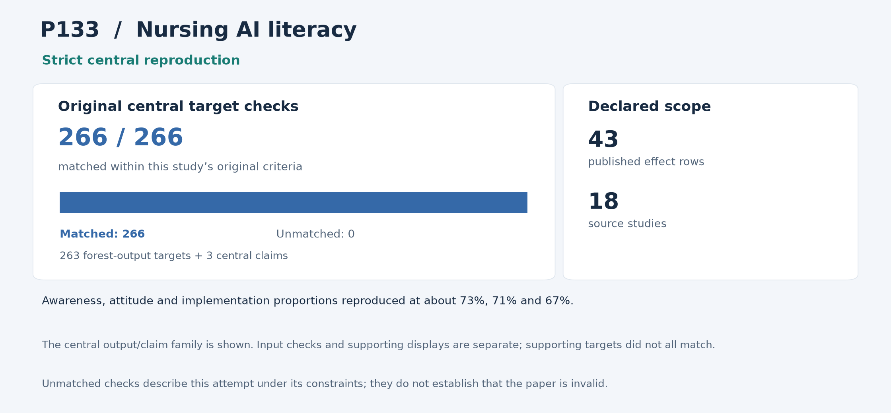

# P133: AI literacy and competency in nursing education: preparing students and faculty members for an AI-enabled future-a systematic review and meta-analysis

**Outcome: Strict central reproduction.** This is a central-result reproduction; whole-paper reproduction is not claimed.

**Interpreting non-reproduction.** A failed comparison or unmatched result means that this reproduction programme did not recover that result within its stated scope and constraints, including the available inputs, methods, software and local resources. It does not establish that the paper or its conclusions are invalid. Work outside the attempted scope was not tested by this programme.

[Paper / DOI](https://doi.org/10.3389/fmed.2025.1681784) · [Source and acquisition records](INPUTS.json) · [Programme overview](../../README.md)

## Study in plain language

### What the original authors studied

The original authors brought together studies of AI awareness, attitudes and implementation in nursing education. Their central quantitative figures estimate proportions for these three outcomes. A pooled proportion combines study estimates while allowing for differences in their precision and substantial differences between studies. It is a summary of the reported measurements, not a direct test that a given nurse or student can use AI safely.

### What the reproduction programme checked

The reproduction programme retained all 43 reported rows from 18 studies: 15 for awareness, 16 for attitudes and 12 for implementation. The reproduction code transformed the proportions for statistical calculation, combined them, calculated uncertainty and converted them back to percentages. The reproduction code also reconstructed study intervals, weights and variation between studies. All 129 input comparisons, 263 central figure comparisons and three central claims passed; a separately written reproduction implementation passed 312,782 checks. The main estimates reproduce as approximately 73%, 71% and 67%, with their published intervals.

### What was reproduced and what it means

The programme reproduced the three central figures but matched only 19 of 114 supporting displays under its available inputs and fixed method. Those unmatched comparisons do not determine the paper’s validity. The authors’ exact software settings were unavailable, so the programme fixed a source-supported method before calculation, not a recovered historical setup. Repeating the underlying studies, screening or qualitative synthesis was outside scope. Subgroup and source inconsistencies remain unresolved by this reconstruction; it was not a clinical-competence test.

The sections below give the detailed comparisons and caveats. For common statistical and model terms, see the [reading guide](../../READING_GUIDE.md).

## Reproduction at a glance

The chart retains this programme's original central comparison criteria alongside the adopted outcome. Targets differ across studies and are not a common quality score. [Chart data](visuals/summary.json) · [Graph definitions and rendering code](../../visuals/README.md).

**Result.** The three central prevalence/heterogeneity forest analyses were reproduced from every released effect row.

## What was reproduced

All 43 rows across 18 studies remain: awareness 15, attitude 16 and implementation 12. The analysis includes 129 input comparisons, 263 forest-output comparisons, three central claims, six specified pipelines and complete leave-one-out controls.

## Agreement and differences

All central comparisons and 312,782 independent comparisons pass. Recreated random prevalences are awareness 0.73 [0.64, 0.81], attitude 0.71 [0.63, 0.78] and implementation 0.67 [0.55, 0.78]. High heterogeneity also matches.

The programme matched only 19/114 supporting displays with its reconstruction; all 95 unsuccessful comparisons remain explicit.

**Limits of this reproduction:** The programme did not match every supporting display under its source-supported reconstruction; the authors' exact transformation and settings were unavailable. These unsuccessful comparisons describe the limits of that reconstruction and do not establish that the paper or its supporting conclusions are invalid.

## Issues and omitted work

The exact author transformation/settings are not uniquely reported. Freeman–Tukey/REML was fixed prospectively as a source-supported reconstruction, not recovered historical settings. Country, moderator, subgroup and study-count conflicts remain. An audit manifest-alias repair changed no mathematics or criteria.

Original studies, screening, qualitative synthesis and extraction/coding were not repeated. No subgroup assignments were invented. This succeeds for the three forest contributions, not the whole statistical paper, nursing competence itself or the wider moderator conclusions.

## Paper and selection

- [Original paper or public release](https://doi.org/10.3389/fmed.2025.1681784)

- Identified public release: 2025-11-26.
- Retained selection observation: 56 citations, OpenAlex. Exact capture time unknown.
- Positive November 2025 substantive release; no citation refresh.
- Citation values are retained selection evidence, not current counts.

The route was **released synthesis**, using local computation without paid services or additional API keys. The code below is the programme's implementation and independent audit tooling for this scope.

## Code and rerunning

Start with [REPRODUCE.md](REPRODUCE.md). It identifies the scientific entry points, dependencies, historical commands and known execution constraints. The following code is included in this folder:

- [candidate_core007.py](code/candidate_core007.py) — statically imported runner/auditor helper
- [candidate_pipeline007.py](code/candidate_pipeline007.py) — statically imported runner/auditor helper
- [candidate_worker009.py](code/candidate_worker009.py) — scientific entry
- [engineering_checks004.py](code/engineering_checks004.py) — statically imported runner/auditor helper
- [synthetic_fixture004.py](code/synthetic_fixture004.py) — statically imported runner/auditor helper
- [audit_p133_complete003.py](code/audit_p133_complete003.py) — scientific entry

**Licensing:** this study includes a GPL-covered primary statistical program. The independent auditor and original documentation use MIT. See [LICENSING.md](LICENSING.md) for the exact scope.

The folder also provides [a local artifact tool](reproduce.py), [input acquisition records](INPUTS.json), and [source-to-publication hashes](PROVENANCE.json). The artifact tool can check file integrity or reconstruct the original relative layout; it does not rerun the scientific experiment.

## Results and audit trail

- [audit_output__AUDIT_MANIFEST.json](results/audit_output__AUDIT_MANIFEST.json) — successful original run/audit product, target comparison, figure or hash manifest
- [audit_output__AUDIT_STATUS.json](results/audit_output__AUDIT_STATUS.json) — successful original run/audit product, target comparison, figure or hash manifest
- [audit_output__INDEPENDENT_ALL506_SOURCE_COMPARISONS.json](results/audit_output__INDEPENDENT_ALL506_SOURCE_COMPARISONS.json) — successful original run/audit product, target comparison, figure or hash manifest
- [audit_output__INDEPENDENT_CANONICAL_INPUT.json](results/audit_output__INDEPENDENT_CANONICAL_INPUT.json) — successful original run/audit product, target comparison, figure or hash manifest
- [audit_output__INDEPENDENT_SUPPORTING_CLAIM_DIAGNOSTICS.json](results/audit_output__INDEPENDENT_SUPPORTING_CLAIM_DIAGNOSTICS.json) — successful original run/audit product, target comparison, figure or hash manifest
- [audit_output__phase_events.jsonl](results/audit_output__phase_events.jsonl) — successful original run/audit product, target comparison, figure or hash manifest
- [audit_output__progress.json](results/audit_output__progress.json) — successful original run/audit product, target comparison, figure or hash manifest
- [final_original029_closure001__ALL312782_COMPLETE_LOG_CENSUS_AND_TALLIES001.json](results/final_original029_closure001__ALL312782_COMPLETE_LOG_CENSUS_AND_TALLIES001.json) — successful original run/audit product, target comparison, figure or hash manifest
- [final_original029_closure001__ALL95_COMPLETE_SUPPORTING_DISAGREEMENTS001.json](results/final_original029_closure001__ALL95_COMPLETE_SUPPORTING_DISAGREEMENTS001.json) — successful original run/audit product, target comparison, figure or hash manifest
- [final_original029_closure001__COMPLETE_ORIGINAL029_NATIVE_OUTPUT___e3726583.json](results/final_original029_closure001__COMPLETE_ORIGINAL029_NATIVE_OUTPUT___e3726583.json) — successful original run/audit product, target comparison, figure or hash manifest
- [final_original029_closure001__FINAL_COMPLETE_ORIGINAL029_CLOSURE___a3d68e42.json](results/final_original029_closure001__FINAL_COMPLETE_ORIGINAL029_CLOSURE___a3d68e42.json) — successful original run/audit product, target comparison, figure or hash manifest
- [final_original029_closure001__REPORT_SUMMARY_AND_PROVENANCE001.json](results/final_original029_closure001__REPORT_SUMMARY_AND_PROVENANCE001.json) — successful original run/audit product, target comparison, figure or hash manifest

- [root_review_P133_complete_central_success001.json](evidence/root_review_P133_complete_central_success001.json) — compact independent/ROOT success and closure decision
- [ALL_SIX_EARLIEST_RELEASE_PROPOSED_DISPOSITIONS001.json](evidence/ALL_SIX_EARLIEST_RELEASE_PROPOSED_DISPOSITIONS001.json) — Final pinned execution/configuration/audit record

Pass/fail labels and unmatched values in the linked historical records describe this programme's checks under its recorded constraints; they are not judgments on paper validity. Missing or unattempted components were not tested.

The full included-file index is [PROVENANCE.json](PROVENANCE.json). The [historical report](evidence/HISTORICAL_REPORT.txt) preserves the counted report's original qualifications; old warehouse paths there are historical references rather than public download links. Published copies normalize workstation paths and UTF-8 encoding. Their hashes are recorded separately from the original archive hashes.
