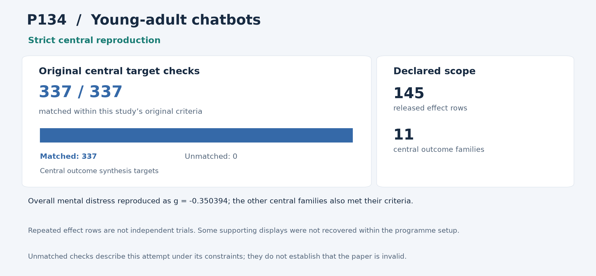

# P134: The Effectiveness of AI Chatbots in Alleviating Mental Distress and Promoting Health Behaviors Among Adolescents and Young Adults: Systematic Review and Meta-Analysis

**Outcome: Strict central reproduction.** This is a central-result reproduction; whole-paper reproduction is not claimed.

**Interpreting non-reproduction.** A failed comparison or unmatched result means that this reproduction programme did not recover that result within its stated scope and constraints, including the available inputs, methods, software and local resources. It does not establish that the paper or its conclusions are invalid. Work outside the attempted scope was not tested by this programme.

[Paper / DOI](https://doi.org/10.2196/79850) · [Source and acquisition records](INPUTS.json) · [Programme overview](../../README.md)

## Study in plain language

### What the original authors studied

The original authors asked what earlier studies suggest about chatbot interventions for adolescents and young adults, including distress, emotions, wellbeing and health behaviours. They combined multiple studies because any one study may be small or measure a different outcome. Most included chatbots are rule-based or retrieve prepared material; only three use generative AI. The findings should therefore not be read as a test of every modern language-model chatbot.

### What the reproduction programme checked

The reproduction programme used all 145 released effect rows, including 88 comparisons described by means, standard deviations and sample sizes. Rows can recur across outcomes, so they are not 145 independent trials. The reproduction code recomputed all eleven central outcome summaries, their confidence intervals, study counts and statistical directions. All 337 central comparisons and 51,910 independent checks passed. Overall mental distress reproduced as a standardized difference of about −0.35, with an interval from −0.46 to −0.24; negative values indicate lower distress under the source’s coding.

### What was reproduced and what it means

The programme reproduced the central synthesis but could not match eight supporting displays with its available inputs and methods. This does not determine the paper’s validity. Some subgroup assignments, within-trial correlations and auxiliary methods were unavailable to the programme. Its source-transcription corrections preceded calculation. Recruitment, intervention delivery, study selection and risk-of-bias reassessment were outside scope, not attempted failures. Agreement therefore does not independently demonstrate effectiveness, safety or suitability for an individual.

The sections below give the detailed comparisons and caveats. For common statistical and model terms, see the [reading guide](../../READING_GUIDE.md).

## Reproduction at a glance

The chart retains this programme's original central comparison criteria alongside the adopted outcome. Targets differ across studies and are not a common quality score. [Chart data](visuals/summary.json) · [Graph definitions and rendering code](../../visuals/README.md).

**Result.** All eleven central outcome syntheses were reproduced from released summaries.

## What was reproduced

All 145 effect rows, 88 mean/SD/N contrasts and 31 trial-metadata records were retained, including every central pooled estimate, interval, count and significance direction. Repeated outcome rows are not 145 independent trials.

## Agreement and differences

All 337 central comparisons and 51,910 independent checks pass. Overall mental distress is g=-0.350394, 95% CI [-0.456007, -0.244781]; the other ten central families also meet their precision limits.

The programme did not match eight supporting numerical/display comparisons; 324/332 such comparisons agree. Those discrepancies remain unsuccessful reproduction comparisons.

**Limits of this reproduction:** The supporting displays that did not match were unsuccessful comparisons in this programme, with limits including unavailable subgroup assignments, covariance and auxiliary implementation details. Their cause is not fully established. They do not, by themselves, determine the validity of the paper or its conclusions.

## Issues and omitted work

The programme made ten documented corrections to its source transcriptions before calculation; three proposed corrections were rejected. The programme did not recover all supporting weights, Q and Z displays within its available reconstruction. Exact subgroup assignments, within-trial covariance and trim-and-fill implementation are unavailable.

Most included systems are rule-based or retrieval chatbots; only three use generative AI. Human trials, searching/screening, risk-of-bias/GRADE and unavailable ancillary analyses were not repeated. The statistical reconstruction does not independently confirm treatment efficacy or establish the same result for all modern generative models. No post-result method, scope or tolerance change was made.

## Paper and selection

- [Original paper or public release](https://doi.org/10.2196/79850)

- Identified public release: 2025-06-30.
- Retained selection observation: 44 citations, OpenAlex. Exact capture time unknown.
- Publisher public preprintJune30 predates its later version of record.
- Citation values are retained selection evidence, not current counts.

The route was **released synthesis**, using local computation without paid services or additional API keys. The code below is the programme's implementation and independent audit tooling for this scope.

## Code and rerunning

Start with [REPRODUCE.md](REPRODUCE.md). It identifies the scientific entry points, dependencies, historical commands and known execution constraints. The following code is included in this folder:

- [audit_independent_source_formula_local004.py](code/audit_independent_source_formula_local004.py) — scientific entry
- [run_complete_central003.py](code/run_complete_central003.py) — scientific entry

The folder also provides [a local artifact tool](reproduce.py), [input acquisition records](INPUTS.json), and [source-to-publication hashes](PROVENANCE.json). The artifact tool can check file integrity or reconstruct the original relative layout; it does not rerun the scientific experiment.

## Results and audit trail

- [original001__INDEPENDENT_ALL337_PRIMARY_CHECKS.json](results/original001__INDEPENDENT_ALL337_PRIMARY_CHECKS.json) — successful original run/audit product, target comparison, figure or hash manifest
- [original001__INDEPENDENT_ALL_ORIGINAL_COMPUTATIONS.json](results/original001__INDEPENDENT_ALL_ORIGINAL_COMPUTATIONS.json) — successful original run/audit product, target comparison, figure or hash manifest
- [original001__INDEPENDENT_ALL_SUPPORTING_SOURCE_COMPARISONS.json](results/original001__INDEPENDENT_ALL_SUPPORTING_SOURCE_COMPARISONS.json) — successful original run/audit product, target comparison, figure or hash manifest
- [original001__OUTPUT_MANIFEST.json](results/original001__OUTPUT_MANIFEST.json) — successful original run/audit product, target comparison, figure or hash manifest
- [original001__SUMMARY.json](results/original001__SUMMARY.json) — successful original run/audit product, target comparison, figure or hash manifest
- [final_report002__ALL336_SUPPORTING_COMPARISONS.csv](results/final_report002__ALL336_SUPPORTING_COMPARISONS.csv) — successful original run/audit product, target comparison, figure or hash manifest
- [final_report002__ALL337_CENTRAL_GATES.csv](results/final_report002__ALL337_CENTRAL_GATES.csv) — successful original run/audit product, target comparison, figure or hash manifest
- [final_report002__FINAL_READABILITY_AND_FAILURE_HISTORY_SUPPLEMENT003.json](results/final_report002__FINAL_READABILITY_AND_FAILURE_HISTORY_SUPPLEMENT003.json) — successful original run/audit product, target comparison, figure or hash manifest
- [final_report002__REPORT.json](results/final_report002__REPORT.json) — successful original run/audit product, target comparison, figure or hash manifest
- [final_report002__REPORT.md.txt](results/final_report002__REPORT.md.txt) — successful original run/audit product, target comparison, figure or hash manifest
- [final_report002__SUMMARY_REPORT.md.txt](results/final_report002__SUMMARY_REPORT.md.txt) — successful original run/audit product, target comparison, figure or hash manifest
- [original002__ALL337_PRIMARY_CHECKS.json](results/original002__ALL337_PRIMARY_CHECKS.json) — successful original run/audit product, target comparison, figure or hash manifest

- [root_review_P134-final-central-success001.json](evidence/root_review_P134-final-central-success001.json) — compact independent/ROOT success and closure decision
- [ALL_SIX_EARLIEST_RELEASE_PROPOSED_DISPOSITIONS001.json](evidence/ALL_SIX_EARLIEST_RELEASE_PROPOSED_DISPOSITIONS001.json) — Final pinned execution/configuration/audit record

Pass/fail labels and unmatched values in the linked historical records describe this programme's checks under its recorded constraints; they are not judgments on paper validity. Missing or unattempted components were not tested.

The full included-file index is [PROVENANCE.json](PROVENANCE.json). The [historical report](evidence/HISTORICAL_REPORT.txt) preserves the counted report's original qualifications; old warehouse paths there are historical references rather than public download links. Published copies normalize workstation paths and UTF-8 encoding. Their hashes are recorded separately from the original archive hashes.
