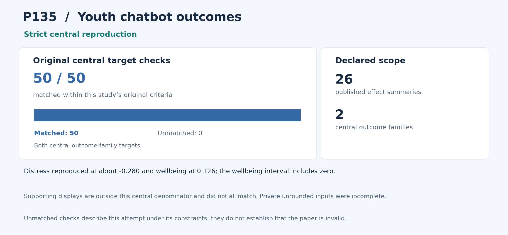

# P135: Chatbot-Delivered Interventions for Improving Mental Health Among Young People: A Systematic Review and Meta-Analysis

**Outcome: Strict central reproduction.** This is a central-result reproduction; whole-paper reproduction is not claimed.

**Interpreting non-reproduction.** A failed comparison or unmatched result means that this reproduction programme did not recover that result within its stated scope and constraints, including the available inputs, methods, software and local resources. It does not establish that the paper or its conclusions are invalid. Work outside the attempted scope was not tested by this programme.

[Paper / DOI](https://doi.org/10.1111/wvn.70059) · [Source and acquisition records](INPUTS.json) · [Programme overview](../../README.md)

## Study in plain language

### What the original authors studied

The original authors asked whether studies of chatbot-delivered interventions show changes in young people’s distress and wellbeing. They combined reported results rather than conducting one new trial. A pooled effect is a weighted summary of those results on a common scale. Its uncertainty interval is essential: an estimate above or below zero can still be compatible with no difference when the interval spans zero.

### What the reproduction programme checked

The reproduction programme retained all 26 published effect summaries: 18 distress effects from 11 trials and eight wellbeing effects from seven trials. The reproduction analysis independently recomputed both central statistical families, including their uncertainty, using the method fixed before outcomes. The programme also retained all 410 planned original, rounding and leave-out fits. All 50 primary comparisons passed, alongside 26,724 independent comparisons. Distress reproduced as about −0.280, with an interval from −0.461 to −0.099. Wellbeing reproduced as 0.126, with an interval from −0.161 to 0.414.

### What was reproduced and what it means

The programme reproduced the central distress and wellbeing summaries. With its available inputs and fixed method, it matched 190 supporting displays, could not match 109 and could not evaluate 32 unavailable displays. These outcomes do not determine the paper’s validity. Private unrounded inputs, covariance information and historical analysis details remained unavailable. Repeating trials and the systematic review was outside scope, not attempted failures. This is a central reconstruction, not independent clinical-effectiveness or care-suitability evidence.

The sections below give the detailed comparisons and caveats. For common statistical and model terms, see the [reading guide](../../READING_GUIDE.md).

## Reproduction at a glance

The chart retains this programme's original central comparison criteria alongside the adopted outcome. Targets differ across studies and are not a common quality score. [Chart data](visuals/summary.json) · [Graph definitions and rendering code](../../visuals/README.md).

**Result.** Both complete central outcome families were reproduced from all 26 published effect summaries.

## What was reproduced

The analysis retains 18 distress effects from 11 trials and eight wellbeing effects from seven trials, the fixed variance convention, two-component REML and residual Student-t intervals. All 410 original, rounding and leave-out fits were included.

## Agreement and differences

All 50 primary comparisons and 26,724 independent comparisons pass. Distress is g=-0.279782453, 95% CI [-0.460642707, -0.098922199], matching -0.28 [-0.46, -0.10]. Wellbeing is 0.126241650 [-0.161469401, 0.413952700], matching 0.13 [-0.16, 0.41].

Of 331 supporting displays, the programme matched 190, could not assess 32 because they were unavailable, and did not match 109 within its reconstruction. Central success does not change those outcomes.

**Limits of this reproduction:** The programme did not recover all supporting displays from the available summaries and reconstruction conventions; some displays could not be checked at all. Private unrounded inputs, provenance and covariance were incomplete. These are limits of the reproduction attempt, without establishing that the paper or its conclusions are invalid.

## Issues and omitted work

Private unrounded inputs, original analysis provenance and covariance information are incomplete. The reconstruction’s model convention was fixed before outcomes and is not claimed to recover every historical setting. Earlier interrupted work and repairs were preserved; previously completed independent calculations were reused only after exact verification.

The human trials, systematic review and private analysis project were not reconstructed. The result recovers the published distress and wellbeing synthesis, not independent clinical effectiveness.

## Paper and selection

- [Original paper or public release](https://doi.org/10.1111/wvn.70059)

- Identified public release: 2025-07-15.
- Retained selection observation: 54 citations, OpenAlex. Exact capture time unknown.
- Related conference material concerns the same study and adds no distinct paper.
- Citation values are retained selection evidence, not current counts.

The route was **released synthesis**, using local computation without paid services or additional API keys. The code below is the programme's implementation and independent audit tooling for this scope.

## Code and rerunning

Start with [REPRODUCE.md](REPRODUCE.md). It identifies the scientific entry points, dependencies, historical commands and known execution constraints. The following code is included in this folder:

- [run_two_family_matrix_source004.py](code/run_two_family_matrix_source004.py) — scientific entry
- [audit_p135_central015.py](code/audit_p135_central015.py) — scientific entry

The folder also provides [a local artifact tool](reproduce.py), [input acquisition records](INPUTS.json), and [source-to-publication hashes](PROVENANCE.json). The artifact tool can check file integrity or reconstruct the original relative layout; it does not rerun the scientific experiment.

## Results and audit trail

- [original003__AUDIT_STATUS.json](results/original003__AUDIT_STATUS.json) — successful original run/audit product, target comparison, figure or hash manifest
- [original003__CONTINUATION_COMPLETE410_CALL_IDENTITY_RECEIPT015.json](results/original003__CONTINUATION_COMPLETE410_CALL_IDENTITY_RECEIPT015.json) — successful original run/audit product, target comparison, figure or hash manifest
- [original003__ENGINEERING_PROGRESS.json](results/original003__ENGINEERING_PROGRESS.json) — successful original run/audit product, target comparison, figure or hash manifest
- [original003__INDEPENDENT_ALL50_PRIMARY_CHECKS.json](results/original003__INDEPENDENT_ALL50_PRIMARY_CHECKS.json) — successful original run/audit product, target comparison, figure or hash manifest
- [original003__INDEPENDENT_ALL_SUPPORTING_SOURCE_COMPARISONS.json](results/original003__INDEPENDENT_ALL_SUPPORTING_SOURCE_COMPARISONS.json) — successful original run/audit product, target comparison, figure or hash manifest
- [original003__OUTPUT_MANIFEST.json](results/original003__OUTPUT_MANIFEST.json) — successful original run/audit product, target comparison, figure or hash manifest
- [original001__ALL50_PRIMARY_CHECKS.json](results/original001__ALL50_PRIMARY_CHECKS.json) — successful original run/audit product, target comparison, figure or hash manifest
- [original001__ALL_ORIGINAL_COMPUTATIONS.json](results/original001__ALL_ORIGINAL_COMPUTATIONS.json) — successful original run/audit product, target comparison, figure or hash manifest
- [original001__ALL_SUPPORTING_SOURCE_COMPARISONS.json](results/original001__ALL_SUPPORTING_SOURCE_COMPARISONS.json) — successful original run/audit product, target comparison, figure or hash manifest
- [original001__NUMERICAL_OPTIMIZER_TRACE.json](results/original001__NUMERICAL_OPTIMIZER_TRACE.json) — successful original run/audit product, target comparison, figure or hash manifest
- [original001__OUTPUT_MANIFEST.json](results/original001__OUTPUT_MANIFEST.json) — successful original run/audit product, target comparison, figure or hash manifest
- [original001__RESOURCE_SAMPLES.json](results/original001__RESOURCE_SAMPLES.json) — successful original run/audit product, target comparison, figure or hash manifest

- [root_review_P135_complete_central_success001.json](evidence/root_review_P135_complete_central_success001.json) — compact independent/ROOT success and closure decision
- [ALL_SIX_EARLIEST_RELEASE_PROPOSED_DISPOSITIONS001.json](evidence/ALL_SIX_EARLIEST_RELEASE_PROPOSED_DISPOSITIONS001.json) — Final pinned execution/configuration/audit record

Pass/fail labels and unmatched values in the linked historical records describe this programme's checks under its recorded constraints; they are not judgments on paper validity. Missing or unattempted components were not tested.

The full included-file index is [PROVENANCE.json](PROVENANCE.json). The [historical report](evidence/HISTORICAL_REPORT.txt) preserves the counted report's original qualifications; old warehouse paths there are historical references rather than public download links. Published copies normalize workstation paths and UTF-8 encoding. Their hashes are recorded separately from the original archive hashes.
