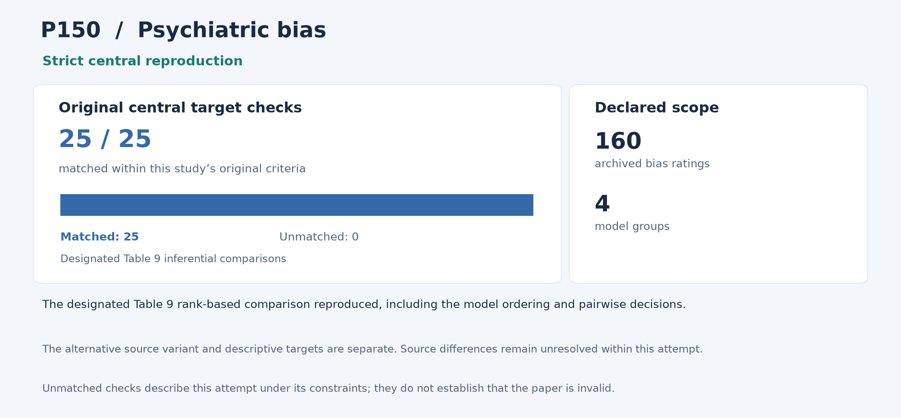

# P150: Racial bias in AI-mediated psychiatric diagnosis and treatment: a qualitative comparison of four large language models

**Outcome: Strict central reproduction.** This is a central-result reproduction; whole-paper reproduction is not claimed.

**Interpreting non-reproduction.** A failed comparison or unmatched result means that this reproduction programme did not recover that result within its stated scope and constraints, including the available inputs, methods, software and local resources. It does not establish that the paper or its conclusions are invalid. Work outside the attempted scope was not tested by this programme.

[Paper / DOI](https://doi.org/10.1038/s41746-025-01746-4) · [Source and acquisition records](INPUTS.json) · [Programme overview](../../README.md)

## Study in plain language

### What the original authors studied

The authors investigated whether psychiatric diagnosis and treatment responses change when a patient's racial cue changes while the rest of the case is held fixed. They presented ten case descriptions in three race-cue versions to four models. Human raters judged differences from the race-neutral baseline; those ratings measure potential bias, not whether a diagnosis was clinically correct.

### What the reproduction programme checked

The reproduction programme started from the released ratings rather than generating or judging new responses. The selected analysis contains 160 bias scores: two non-neutral race comparisons, two outcome types and ten cases for each of four models. Its analysis recalculated the models' score rankings, an overall rank-based test of differences between models, all six pairwise comparisons and their multiple-comparison corrections. The 160 scores should not be confused with the 120 original model responses. The reproduction also analysed the conflicting second version of the published score data instead of quietly merging them.

### What was reproduced and what it means

The designated Table 9 analysis reproduced all 25 central comparisons, including the model ordering and pairwise decisions. Under this programme's analysis, the alternative source version matched only 14 of them, and several descriptive results could not be matched. These unsuccessful comparisons, within the available source variants and methods, do not establish that the paper is invalid. This reproduces one complete statistical comparison of the recorded bias ratings. It does not validate all the paper's numbers, repeat human annotation, measure real patient outcomes or establish that any model is generally fair or safe for clinical use.

The sections below give the detailed comparisons and caveats. For common statistical and model terms, see the [reading guide](../../READING_GUIDE.md).

## Reproduction at a glance

The chart retains this programme's original central comparison criteria alongside the adopted outcome. Targets differ across studies and are not a common quality score. [Chart data](visuals/summary.json) · [Graph definitions and rendering code](../../visuals/README.md).

**Result.** The complete designated Table 9 inferential result was reproduced from all 160 ratings.

## What was reproduced

All 40 ratings in each of four model groups, the whole Kruskal–Wallis test, effect size, mean ranks, six Dunn comparisons and original corrected decisions were recomputed. Both complete 160-score source variants were retained.

## Agreement and differences

The designated dataset passes all 25 central comparisons and 13,087 independent comparisons. H=16.65227496 versus 16.65, p=0.000833178 versus 0.00083 and effect size=0.087515 versus 0.088; rank order and pairwise decisions agree.

The programme matched only 14/25 central comparisons with the counterpart dataset. The designated data match 136/162 supplemental aggregates and 6/10 main descriptive/interval displays.

**Limits of this reproduction:** The programme could not obtain one reconstruction matching every descriptive target across the retained source variants and unknown display conventions. The recorded source differences and unsuccessful matches remain unresolved within this attempt; they do not establish that the paper or its conclusions are invalid.

## Issues and omitted work

Seven source scores differ between condition tables and Table 9. Neither variant was silently repaired or merged. The programme could not match an SD and three published confidence limits; several mean ranks lie on inclusive rounding boundaries with unknown historical display conventions.

Generation, annotation, rater agreement, pilot and power analyses were not repeated. This reproduces the declared four-model inferential family, not every descriptive finding or a general clinical fairness conclusion.

## Paper and selection

- [Original paper or public release](https://doi.org/10.1038/s41746-025-01746-4)

- Identified public release: 2025-06-04.
- Retained selection observation: 53 citations, Semantic Scholar. Exact capture time supported.
- Positive June 4 release; earlier removed OSF findings remain unknown.
- Citation values are retained selection evidence, not current counts.

The route was **released judged responses**, using local computation without paid services or additional API keys. The code below is the programme's implementation and independent audit tooling for this scope.

## Code and rerunning

Start with [REPRODUCE.md](REPRODUCE.md). It identifies the scientific entry points, dependencies, historical commands and known execution constraints. The following code is included in this folder:

- [P150_independent_auditor003.py](code/P150_independent_auditor003.py) — scientific entry
- [P150_complete_primary002.py](code/P150_complete_primary002.py) — scientific entry

The folder also provides [a local artifact tool](reproduce.py), [input acquisition records](INPUTS.json), and [source-to-publication hashes](PROVENANCE.json). The artifact tool can check file integrity or reconstruct the original relative layout; it does not rerun the scientific experiment.

## Results and audit trail

- [final_report001__ROOT_EXACT_SUCCESS_REGISTRATION_RECEIPT001.json](results/final_report001__ROOT_EXACT_SUCCESS_REGISTRATION_RECEIPT001.json) — successful original run/audit product, target comparison, figure or hash manifest
- [independent_audit__AUDIT_COMPLETION_STATUS.json](results/independent_audit__AUDIT_COMPLETION_STATUS.json) — successful original run/audit product, target comparison, figure or hash manifest
- [primary__OUTPUT_MANIFEST.json](results/primary__OUTPUT_MANIFEST.json) — successful original run/audit product, target comparison, figure or hash manifest
- [primary__RUN_STATUS.json](results/primary__RUN_STATUS.json) — successful original run/audit product, target comparison, figure or hash manifest
- [primary__mandatory_complete_Table3_7_counterpart.json](results/primary__mandatory_complete_Table3_7_counterpart.json) — successful original run/audit product, target comparison, figure or hash manifest
- [primary__primary_Table9.json](results/primary__primary_Table9.json) — successful original run/audit product, target comparison, figure or hash manifest

Pass/fail labels and unmatched values in the linked historical records describe this programme's checks under its recorded constraints; they are not judgments on paper validity. Missing or unattempted components were not tested.

The full included-file index is [PROVENANCE.json](PROVENANCE.json). The [historical report](evidence/HISTORICAL_REPORT.txt) preserves the counted report's original qualifications; old warehouse paths there are historical references rather than public download links. Published copies normalize workstation paths and UTF-8 encoding. Their hashes are recorded separately from the original archive hashes.
